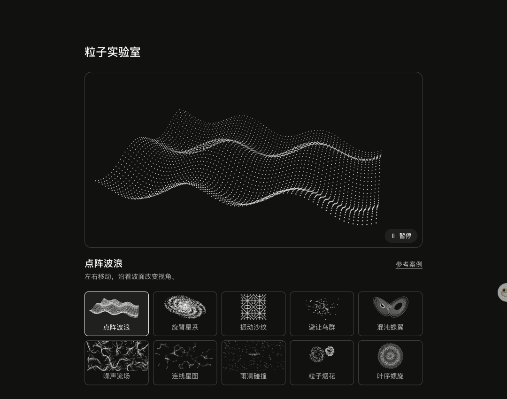
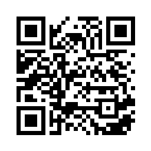

# Ucas Studio Particle Study

[简体中文](README.md) · [GitHub repository](https://github.com/holynova/ucas-particles) · [Live demo](https://ucas-particles.xiaosang.cc/)

An independent motion study of the Ucas Studio homepage, followed by one hundred interactive experiments. Sweep across a founder’s face to scatter the points or open **Particle Lab** to try a different particle system. [Open the Particle Lab](https://ucas-particles.xiaosang.cc/#particle-lab).



## Studio effects

Refresh to replay the particle loading percentage. The main stage cycles through five shapes. Project covers flow between photos and client logos. The two portraits scatter under the pointer and settle back into place. A world map connects Ankara and New York.

The five effects adapt the components delivered by Ucas Studio’s website. Studio marks, project imagery, portraits and fonts originate from the studio. The map uses Natural Earth land outlines distributed with world-atlas 2.0.2. Three.js r160 renders the WebGL effects, while the loader and map use Canvas 2D. [Original website](https://www.ucas.studio/) · [Reference recording](https://xhslink.cn/o/5MoC3vhiXj9)

## Particle Lab

Choose from ten groups of ten. The original gallery covers waves, a spiral galaxy, Chladni sand patterns, flocking, a Lorenz attractor, a noise flow field, linked stars, rain collisions, fireworks or phyllotaxis. Mechanics adds an elastic net, hourglass, double pendulum, magnetic field, wave interference, pendulum waves, piston gas, binary stars, plucked strings and a cylinder wake. Forms and Growth includes a torus knot, polar flower, ice crystal, Hilbert curve, Mandelbrot set, reaction–diffusion, branching tree, metaballs, spirograph and Game of Life. Light and Waves explores focusing, refraction, Doppler wavefronts, moiré, Fourier synthesis, kaleidoscopes, single-slit diffraction, eclipses, Lissajous curves and caustics. Groups and Paths adds a maze, Langton’s ant, Voronoi cells, a Galton board, cyclic pursuit, contour lines, odd-even sorting, knight paths, branching lightning and circle packing. Five more groups explore astronomy, weather and landforms, paper and textiles, geometry and dimensions, and rhythmic machines. Try measuring a planetary transit, dropping scree, closing a zipper, slicing a cube or toggling a visual step sequencer. Each experiment includes an interaction hint and a link to a reference or implementation. Focus the canvas and use the arrow keys to move the pointer, then press Space or Enter to tap. Animation pauses offscreen.

## Run locally

Open the root `index.html` in a browser. It embeds the images, fonts, map and rendering code. To rebuild it, run the following commands in the repository root.

```sh
npm ci
npm run build
```

The layout and component settings live in `src/main.jsx`. The five original-site studies are in `src/effects/`. The [scene catalog](src/lab/scenes.js) links the implementations for all ten groups.

## Publish

Cloudflare Pages builds the GitHub `main` branch with `npm run build` and serves `dist/` at the custom domain. Push a commit with `git push origin main` to trigger a release. The hosted build includes Umami analytics. The root HTML remains self-contained for offline use.

Scan the QR code to open the live demo.


