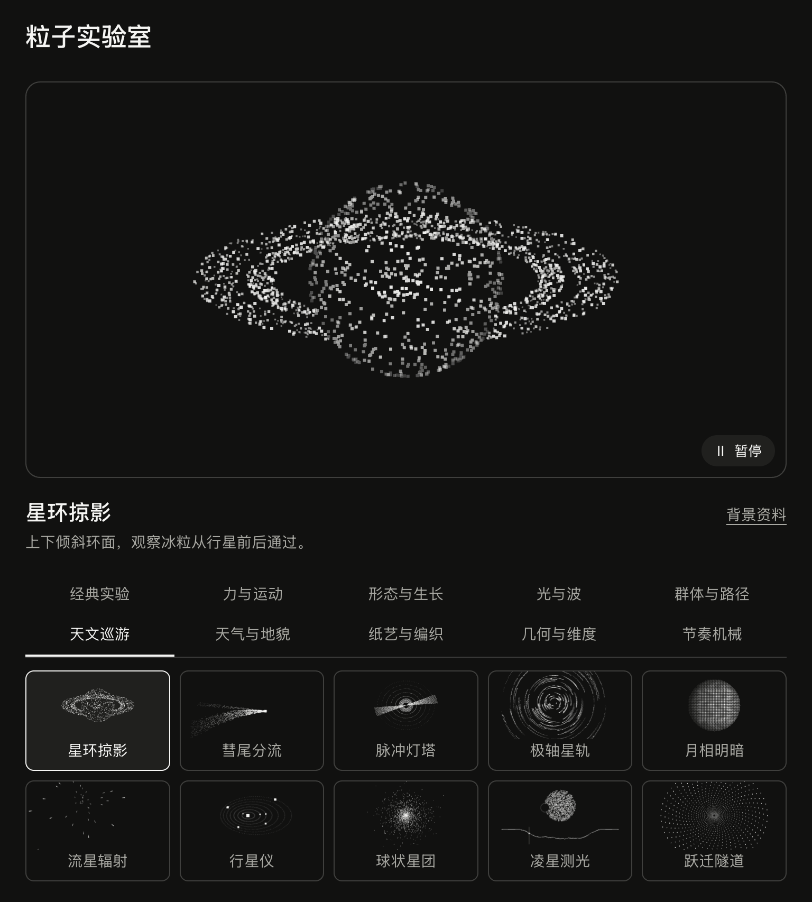

# Ucas Studio 粒子动效复刻

[English](README.en.md) · [GitHub 仓库](https://github.com/holynova/ucas-particles) · [自定义域名（待验证）](https://ucas-particles.xiaosang.cc/)

五组原站动效复刻与一百个可独立操作的粒子实验。[在 Cloudflare Pages 打开粒子实验室](https://ucas-particles.pages.dev/#particle-lab)。



用浏览器打开根目录的 `index.html` 即可体验。字体、头像、项目图、世界地图和渲染代码都已嵌入同一个文件。默认使用参考录像里的深色主题，右上角可切换明暗。作品链接指向工作室原站。

## 交互

- 刷新页面可重播粒子百分比加载动画。
- 首页中央的点阵依次聚成网页、手机、数据面板、品牌规范和 Ucas 字标。横向移动指针可以观察视差，快速划过会带动一片粒子。
- 向下滚动，四张作品卡依次从客户标志聚成彩色封面。悬停可切回粒子标志，移开还原照片。
- 在 Team 区域扫过两位创始人的脸，可以观察局部散开和回弹。页尾世界地图用粒子弧线连接安卡拉和纽约。

## 粒子实验室

从顶部导航的 **Particle Lab** 进入。页面保留 Ucas Studio 的五组动效，地图下方分为十组，每组十个独立场景。每张缩略图都能切换主画布；画布右下角可以暂停播放。键盘用户可聚焦画布，用方向键移动指针，用空格或回车点按。

| 场景 | 本地体验 | 参考案例 |
|---|---|---|
| 点阵波浪 | 横移改变双向波面的观察角度 | [Three.js · Points Waves](https://threejs.org/examples/webgl_points_waves.html) |
| 旋臂星系 | 滑动倾转四臂星盘 | [Three.js · Galaxy](https://threejs.org/examples/webgpu_tsl_galaxy.html) |
| 振动沙纹 | 点按在四组克拉德尼节线之间切换 | [CymaVis · Chladni Plate](https://cymavis.com/chladni) |
| 避让鸟群 | 指针驱散鸟群，移开后重新结队 | [p5.js · Flocking](https://p5js.org/examples/Classes-And-Objects-Flocking/) |
| 混沌蝶翼 | 旋转、观察洛伦兹系统的三维轨迹 | [The Coding Train · Lorenz Attractor](https://thecodingtrain.com/challenges/12-lorenz-attractor) |
| 噪声流场 | 扰动局部流向 | [The Coding Train · Perlin Noise Flow Field](https://thecodingtrain.com/challenges/24-perlin-noise-flow-field) |
| 连线星图 | 指针成为临时节点，连接邻近星点 | [Vincent Garreau · particles.js](https://vincentgarreau.com/particles.js/) |
| 雨滴碰撞 | 移动横板接住雨滴 | [Three.js · Compute Particles Rain](https://threejs.org/examples/webgpu_compute_particles_rain.html) |
| 粒子烟花 | 点按指定位置触发爆裂 | [The Coding Train · Fireworks](https://thecodingtrain.com/challenges/27-fireworks) |
| 叶序螺旋 | 横向移动，在黄金角附近调整种子排列 | [The Coding Train · Phyllotaxis](https://thecodingtrain.com/challenges/30-phyllotaxis) |

上表为「经典实验」。

**力与运动**包括弹性织网、翻转沙漏、混沌双摆、磁极引线、双源干涉、摆阵行波、活塞气室、双星绕行、点阵拨弦与绕流尾迹。

**形态与生长**包括环面纽结、极坐标花冠、六棱冰晶、希尔伯特曲线、分形潜航、反应斑图、风中枝序、软体融球、齿轮画盘与生命棋盘。

**光与波**包括透镜聚焦、水面折光、多普勒波列、莫尔叠网、谐波合成、镜筒万花、单缝衍射、日冕掩星、余辉示波与圆镜焦散。

**群体与路径**包括迷宫寻径、翻格蚂蚁、邻域分疆、高尔顿钉板、多点追逐、等高线岛、奇偶编织、骑士足迹、分叉闪电与圆隙填充。

**天文巡游**包括星环掠影、彗尾分流、脉冲灯塔、极轴星轨、月相明暗、流星辐射、行星仪、球状星团、凌星测光与跃迁隧道。

**天气与地貌**包括沙丘风脊、旋风漏斗、山脊云帽、河口分汊、碎石滑坡、间歇喷泉、潮线泡沫、玄武岩柱、雨窗刮痕与极光帘幕。

**纸艺与编织**包括经纬梭织、折叠地图、翻页书脊、三股辫绳、十字绣样、开合折扇、弦钉绕画、绕线筒、拉链齿合与游针走线。

**几何与维度**包括莫比乌斯带、四维方影、悬链皂膜、超二次体、反演圆网、球面投影、四面体尘、立方截面、余数三角与滚圆摆线。

**节奏机械**包括步进鼓机、凸轮顶杆、槽轮间歇、曲柄滑块、跳槌音板、钉筒八音盒、唱针循槽、翻片计数、斗链提升与光圈叶片。这组用画面呈现节奏与传动。

十组场景统一用单色粒子和 Canvas 2D 在本地绘制。[场景目录](src/lab/scenes.js)连接各组的独立实现。缩略图静态绘制，主画布离开视口时暂停更新。

## 修改与构建

`src/main.jsx` 负责页面、素材和动效参数。五个独立渲染组件位于 `src/effects/`。

| 文件 | 控制的内容 |
|---|---|
| PageLoader.js | 百分比字形与向页面内容飞散的开场 |
| IdeaToProduct.js | 五组形状、过渡时间、主视觉粒子的运动 |
| ParticleImage.js | 彩色图像与客户标志的双向变形 |
| TeamPortrait.js | 面部采样、半色调密度、视差与指针扰动 |
| ContactMap.js | 世界地图、城市节点与航线 |

在此目录执行以下命令，重新生成根目录的 `index.html`。

```sh
npm ci
npm run build
```

## 来源

参考为[小红书演示录像](https://xhslink.cn/o/5MoC3vhiXj9)和 [Ucas Studio 官网](https://www.ucas.studio/)。五个动效组件改编自原站公开交付到浏览器的同名组件。保留了原站粒子着色器、形状与时序，移除了 Framer 编辑器依赖，并将素材读取改成本地打包。版式和组件挂载在本项目中重新实现。

品牌标志、项目图、创始人头像和字体取自 Ucas Studio 官网。地理数据使用 world-atlas 2.0.2 的 Natural Earth 110m 陆地轮廓。主视觉、作品卡和头像使用 Three.js r160 与 WebGL。加载动画与地图使用 Canvas 2D。


## 在线发布

Cloudflare Pages 连接 GitHub 的 `main` 分支，运行 `npm run build` 并发布 `dist/`。修改代码后推送到 `main` 即触发发布。生产页面包含 Umami 访问统计，根目录的离线 HTML 可独立运行。

扫码打开在线版。


